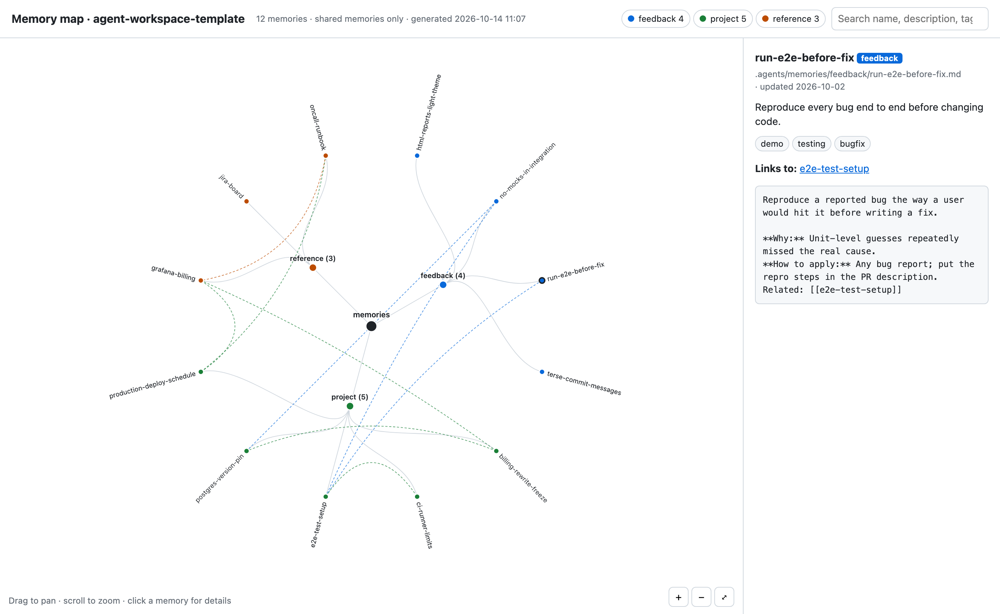

# Agent workspace template

A repository template for working with coding agents such as Claude Code and Codex.
It keeps agent instructions, project memory, reusable skills and hook scripts together in the repository.
Shared memories are versioned with the project so teammates and agents can reuse context across sessions.

Start with [Using this template](#using-this-template) below.
Agent instructions live in [AGENTS.md](AGENTS.md); memory rules live in [.agents/MEMORY.md](.agents/MEMORY.md).

## Using this template

### 1. Create your project

Pick one way.

**From GitHub (recommended).**
Click **Use this template** > **Create a new repository** on the [template page](https://github.com/hoannc0506/agent-workspace-template), or use the GitHub CLI:

```sh
gh repo create my-project --template hoannc0506/agent-workspace-template --private --clone
cd my-project
git remote add upstream https://github.com/hoannc0506/agent-workspace-template.git
```

Your repository starts with a single clean commit.
The `upstream` remote lets you pull template updates later.

**By cloning.**
Use this to keep the template's history, or when your project is not on GitHub:

```sh
git clone https://github.com/hoannc0506/agent-workspace-template.git my-project
cd my-project
git remote rename origin upstream
git remote add origin <your-project-repo-url>
git push -u origin main
```

### 2. Add your project instructions

1. Add a project section to `AGENTS.md` with what agents should know: the stack, how to build, test and run, and any conventions.
2. Replace this README with your project's own, or keep it as a guide for the agent setup.

## Project structure

```
.
├── AGENTS.md            agent instructions (CLAUDE.md imports it for Claude Code)
├── .agents/             shared by both agents
│   ├── memories/        project memory; rules and index in .agents/MEMORY.md
│   ├── skills/          shared skills
│   ├── hooks/           hooks for both agents
│   └── tools/           memory lint, index and mind-map tools
├── .claude/             Claude Code settings
├── .codex/              Codex settings
├── .github/workflows/   CI for memory-lint, off by default
├── assets/              images used in this README
├── docs/                committed team documentation
├── reports/             local reports, gitignored
└── .worktrees/          local git worktrees, gitignored
```

## Project memory

Project memory records useful context that code alone cannot explain, such as decisions, working preferences and links to runbooks.
Shared memories are committed Markdown files that teammates and agents can read in later sessions.

Agents keep project knowledge as Markdown files in `.agents/memories/<type>/`, one fact per file.
`feedback`, `project` and `reference` memories are committed and shared with the team; `user` memories stay on your machine.
`.agents/MEMORY.md` holds the rules and a generated index that every agent reads at session start.

The template supports four memory types: `feedback`, `project`, `reference` and `user`.
Adding another type requires updating the memory rules and tooling.

From the repository root, run:

```sh
python3 .agents/tools/memory-map.py --open
```

This generates an HTML mind map and opens it in your browser.
The map groups memories by type; dashed lines are `[[name]]` links between memories.
Click a memory to see its header, body and any lint errors.
This screenshot uses the example memories from the `demo` branch.



## Skills and hooks

Skills live in `.agents/skills/` and are shared by both agents:

| Skill | Use it to |
|---|---|
| `memory-manage` | Save, update, delete or review project memories |

Hooks live in `.agents/hooks/` and are registered for both agents:

| Hook | Runs | Does |
|---|---|---|
| `redact-secrets.py` | On every prompt and after tool calls | Blocks prompts containing recognized secret patterns. For matched tool output, masks detected secrets in Claude Code and adds a warning in Codex. |
| `memory-guard.py` | After an agent writes a file | Lints memories, the index and reports, so the agent fixes errors in the same turn |

## Update from the template

Ask your agent to pull in the latest template, for example:

```text
Adopt the latest updates from the agent workspace template:
fetch the `upstream` remote (add https://github.com/hoannc0506/agent-workspace-template.git if it is missing),
merge upstream/main on a new branch (use --allow-unrelated-histories if the histories are unrelated),
preserve project-specific instructions, settings and memories,
review changes to shared tooling and configuration individually, and flag conflicts for review,
then summarize what changed and run python3 .agents/tools/memory-lint.py.
```

Template updates may affect `.agents/` (including its memory rules and tools), `.claude/`, `.codex/`, `.github/workflows/agents-lint.yml` and `AGENTS.md`.
Preserve files under `.agents/memories/` and any project-specific additions to instructions or settings when reviewing these changes.
Review the agent's summary and the diff before merging the branch.
